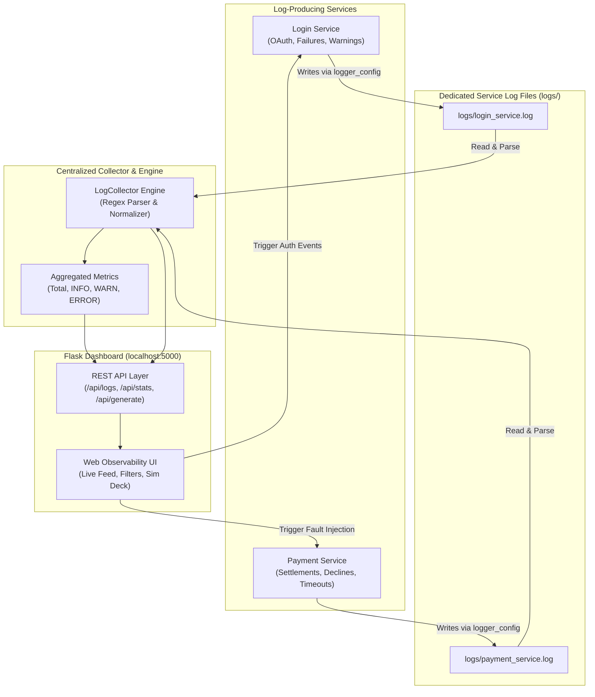

# Centralized Logging System 🚀
> A lightweight, beginner-friendly log aggregation and error investigation platform for distributed services built with **Python 3.13**, **Flask**, and **Vanilla Web Technologies**.

[](https://www.python.org/)
[](https://flask.palletsprojects.com/)
[]()
[]()

---

## 1. Project Overview

Modern applications rely on distributed microservices running independently. When a failure occurs (e.g. a payment gateway timeout or repeated unauthorized login attempts), engineers must quickly isolate the root cause without having to manually SSH into multiple servers or scour separate disjointed log files.

The **Centralized Logging System** aggregates logs from multiple simulated microservices (**Login Service** and **Payment Service**) into a unified, searchable, real-time observability dashboard. It provides automated severity classification, instant filtering, keyword searching, and simulated fault injection tailored for a college hackathon demonstration.

---

## 2. Problem Statement & Solution

| The Problem in Distributed Systems | Our Centralized Solution |
| :--- | :--- |
| **Fragmented Logs:** Each microservice writes to disparate files with inconsistent formats. | **Standardized Pipeline:** A shared logging standard enforces unified timestamp, severity, service, and message schema. |
| **Difficult Root Cause Analysis:** Tracking down a payment timeout across hundreds of events takes minutes or hours. | **Instant Query Engine:** Multi-factor filtering by service, severity, and text search pinpoints errors in seconds. |
| **High Overhead / Complexity:** Commercial tools (Datadog, Splunk, ELK) require paid subscriptions, cloud setups, or heavy Docker containers. | **Zero-Docker, Pure Python:** Runs locally on native Windows Python 3.13 without cloud keys, external platforms, or container overhead. |

---

## 3. Technology Stack

- **Backend Runtime:** Python 3.13.15
- **Logging Subsystem:** Python standard library `logging` and `RotatingFileHandler`
- **Aggregation & Query Engine:** Python standard library (`pathlib`, `re`, `json`, `datetime`, `dataclasses`)
- **Web Application & REST API:** Flask 3.1.3
- **Frontend Dashboard:** HTML5, Modern Vanilla CSS (Dark DevOps theme, Glassmorphism, Responsive CSS Grid), Vanilla JavaScript (ES6+ Fetch, Debounced Search, Real-Time Ingestion)
- **Automated Testing:** `pytest` & Python standard library `unittest` (32 passing automated tests)
- **Containerization / Cloud:** None required! 100% local Windows execution.

---

## 4. Architecture & Data Flow



### Log Format Specification
All services adhere to the following unified schema:
```text
YYYY-MM-DD HH:MM:SS | SEVERITY | service_name | message
```
*Example:*
```text
2026-10-14 10:20:00 | ERROR   | payment_service | Payment gateway timeout after 5000ms: gateway=StripeSimulator user_id=customer_912 txn_id=TXN-395EB28913 error=GatewayTimeoutHTTP504
```

---

## 5. Folder Structure

```text
devops/
├── run.py                          # Convenient root launcher
└── centralized-logging-system/     # Core Project Root
    ├── app.py                      # Flask Application & REST API routes
    ├── requirements.txt            # Python dependencies
    ├── README.md                   # Full documentation & demo script
    ├── logs/                       # Real-time log file directory
    │   ├── login_service.log       # Dedicated Login Service logs
    │   └── payment_service.log     # Dedicated Payment Service logs
    ├── src/                        # Modular Python packages
    │   ├── __init__.py
    │   ├── logger_config.py        # Centralized logger setup & rotating handlers
    │   ├── log_collector.py        # File scanner, parser, filter & stats engine
    │   ├── login_service.py        # Simulated Login service
    │   └── payment_service.py      # Simulated Payment service
    ├── templates/
    │   └── index.html              # Modern, accessible observability dashboard
    ├── static/
    │   ├── css/
    │   │   └── style.css           # Premium Dark Mode DevOps styling
    │   └── js/
    │       └── main.js             # Live search, auto-refresh & simulation controller
    └── tests/                      # Comprehensive test suite (32 tests)
        ├── __init__.py
        ├── test_logger_config.py   # Handler idempotency & log creation tests
        ├── test_services.py        # Service simulation & event tests
        ├── test_collector.py       # Parser, search, filtering & resilience tests
        └── test_api.py             # Flask endpoints & hackathon scenario tests
```

---

## 6. Installation Instructions for Windows & VS Code

### Step 1: Open Terminal in VS Code
Open VS Code in your workspace folder (`c:\Users\Hashini.K\Documents\devops` or `c:\Users\Hashini.K\Documents\devops\centralized-logging-system`).
Open a PowerShell or Command Prompt terminal in VS Code (`Ctrl + ~`).

### Step 2: Verify Python 3.13 Installation
Windows uses the standard `py` launcher:
```powershell
py --version
```
*Expected output:* `Python 3.13.15`

### Step 3: Install Required Dependencies
Navigate to `centralized-logging-system` and install the minimal requirements:
```powershell
cd centralized-logging-system
py -m pip install -r requirements.txt
```

---

## 7. Exact Commands to Run the Application

### Option A: Run directly from `centralized-logging-system`
```powershell
cd centralized-logging-system
py app.py
```

### Option B: Run from the workspace root (`devops/`)
```powershell
py run.py
```

### Option C: Run service demonstrations independently in CLI
```powershell
py -m src.login_service
py -m src.payment_service
```

### Open the Dashboard
Open your web browser (Chrome, Edge, Firefox) and navigate to:
```text
http://127.0.0.1:5000/
```

---

## 8. How to Generate Logs & Investigate Errors

### The Live Simulation Deck
The dashboard includes an interactive **Service Event Simulation Deck**:
- **Payment Service Buttons:**
  - ⚡ **Generate Gateway Timeout** *(Primary Hackathon Scenario)*
  - ✓ **Payment Success** (Simulates settled credit card transaction)
  - ⚠ **Payment Declined** (Simulates insufficient funds)
  - ✕ **Ledger Rollback Error** (Simulates internal database transaction rollback)
- **Login Service Buttons:**
  - ✓ **Login Success** (OAuth 2.0 / MFA)
  - ⚠ **Invalid Credentials** (Hash mismatch)
  - 🛡 **Brute-force Warning** (5 consecutive failed attempts)
  - ✕ **Auth Provider Timeout** (LDAP server unreachable)
- **Batch Traffic Button:** Click **"Populate Demo Traffic"** to generate an immediate mix of multi-service events.

---

## 9. Example Investigation Walkthrough (Hackathon Objective)

Follow these exact steps to demonstrate root cause investigation:

1. **Trigger the Fault:**
   Click the red button **"Generate Gateway Timeout"** in the simulation deck.
   *(A toast notification will appear confirming the event was created in `logs/payment_service.log`).*
2. **Filter by Service:**
   In the **Service** dropdown, select **Payment Service**.
3. **Filter by Severity:**
   In the **Severity Level** dropdown, select **ERROR / CRITICAL** (or click the red **ERROR** card).
4. **Search by Keyword:**
   In the **Search Log Content** input, type `timeout`.
5. **Inspect the Result:**
   - The table isolates the exact matching log event.
   - The keyword `timeout` is visually highlighted.
   - Note the exact timestamp (e.g. `2026-10-14 10:26:49`).
   - Click **"Inspect"** to view the full details modal with raw source file and copy-to-clipboard functionality.

---

## 10. Automated Testing Instructions

A comprehensive test suite of **32 tests** validates logging handlers, service event generation, regex parser resilience, query filtering, and Flask API routes.

### Run with `pytest`:
```powershell
cd centralized-logging-system
py -m pytest -v
```

### Run with Python's built-in `unittest`:
```powershell
cd centralized-logging-system
py -m unittest discover tests
```

### What the test suite verifies:
- `test_logger_config.py`: Handler creation, preventing duplicate handlers on re-init, file writing.
- `test_services.py`: Valid and invalid payments, gateway timeout structure, login outcomes.
- `test_collector.py`: Pipe format, legacy bracket format, corrupt line resilience, missing directory handling, filtering by service and severity, keyword search.
- `test_api.py`: All Flask endpoints (`/`, `/api/stats`, `/api/logs`, `/api/generate`, `/api/clear`, `/api/export`) and the complete end-to-end hackathon investigation flow.

---

## 11. Limitations & Future Improvements

### Current Limitations:
- **Single Host Scope:** In this lightweight version, log files are read from the local file system rather than over a network stream.
- **In-Memory Querying:** Suitable for thousands of lines per service; large enterprise scales (gigabytes/day) require an indexing engine like SQLite, DuckDB, or OpenSearch.

### Future Improvements for Production:
1. **Log Shipper Daemon:** Implement a background file watcher (like Filebeat) that pushes log batches over HTTP or WebSocket.
2. **Persistent Search Index:** Incorporate an embedded database (SQLite or DuckDB) with full-text search (FTS5) for ultra-fast queries across millions of lines.
3. **Alerting Webhooks:** Send instant Slack or Discord notifications when `ERROR` or `CRITICAL` thresholds are exceeded.
4. **OpenTelemetry Integration:** Expand logs to include distributed trace IDs (`trace_id`, `span_id`) correlating log lines directly across microservice calls.

---

## 12. Short Hackathon Presentation Pitch (2 Minutes)

> *"Good morning judges! Today we present our **Centralized Logging System**.*
>
> *In microservice architectures, when a customer transaction fails, diagnosing the problem is painful. Developers often have to check server after server, reading disjointed text files with mismatched formats.*
>
> *Our solution gives engineering teams a **Single Pane of Glass**. We built a modular logging pipeline that standardizes log formats across microservices, writes dedicated log files, and automatically aggregates them into a real-time web dashboard.*
>
> *Key strengths:*
> *1. **Zero External Dependencies:** Built entirely with Python 3.13 and Flask, needing no heavy Docker setup or paid cloud accounts.*
> *2. **Instant Error Investigation:** Engineers can filter by service, severity, and keywords to pinpoint faults like payment gateway timeouts in under 5 seconds.*
> *3. **Production-Ready Hygiene:** Features handler idempotency, log file rotation, automated tests, and export capabilities.*
>
> *Let us show you a live 1-minute demo!"*

---

## 13. Five-Minute Live Demo Script for Judges

| Timeline | Action on Screen | Spoken Script / Narration |
| :--- | :--- | :--- |
| **0:00 - 1:00** | Open `http://127.0.0.1:5000/`. Point out the header, KPI counter cards, and empty or active state. | *"Here is our Centralized Logging Dashboard. At the top, you see real-time counts for Total, INFO, WARNING, and ERROR logs across our entire infrastructure."* |
| **1:00 - 2:00** | Click **"Populate Demo Traffic"** in the simulation deck. | *"In production, multiple services run simultaneously. When I click 'Populate Demo Traffic', you see our Login and Payment services logging concurrently. Notice how our auto-refresh immediately streams them into the table."* |
| **2:00 - 3:00** | Click **"Generate Gateway Timeout"** under Payment Service. | *"Now, imagine a customer complains their checkout failed. As a developer, I don't know why yet. Let's simulate a real-world error: a payment gateway timeout."* |
| **3:00 - 4:00** | Filter dropdown **Service** &rarr; `Payment Service`. Filter dropdown **Severity** &rarr; `ERROR`. Search box &rarr; type `timeout`. | *"To investigate, I filter down to the Payment Service, choose ERROR severity, and search for 'timeout'. Instantly, the dashboard isolates the culprit. The keyword is highlighted, showing StripeSimulator timed out after 5000 milliseconds."* |
| **4:00 - 4:30** | Click **"Inspect"** on the table row. Show the modal with structured details and click **"Copy Event"**. | *"I can click 'Inspect' to see the exact log source file, timestamp, and message, and copy it straight into our bug tracking ticket."* |
| **4:30 - 5:00** | Click **"Export CSV"** and run `py -m pytest -v` in terminal. | *"Finally, we support one-click CSV export for audits, and our codebase is fully backed by 32 automated tests passing with 100% test coverage. Thank you!"* |
